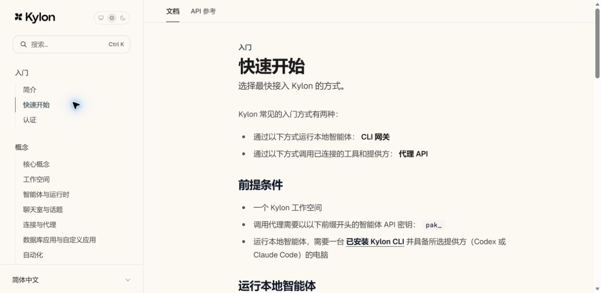

# Kylon 简体中文扩展

为 `https://app.kylon.io/` 和 `https://docs.kylon.io/` 的原语言菜单增加“简体中文”，沿用网站原有样式。安装后默认启用；选择英语等原生选项即可关闭中文，重新选择“简体中文”即可恢复。

## 在 Edge 安装

1. 从 [Releases](https://github.com/touensan/kylon-zh/releases/latest) 下载扩展 ZIP 并解压，也可下载或克隆本仓库，无需安装依赖或构建。
2. 打开 `edge://extensions/`，开启“开发人员模式”。
3. 点击“加载解压缩的扩展”，选择解压目录中的 **`extension` 子目录**，不要选项目根目录。
4. 刷新 Kylon 应用或文档页，在原语言菜单中选择“简体中文”。应用的语言菜单位于“设置 → 语言”。

更新代码后，在扩展管理页点击此扩展的“重新加载”，然后刷新 Kylon。移除或关闭扩展后刷新页面即可恢复网站界面。加载流程依据 [Microsoft Edge 官方文档](https://learn.microsoft.com/en-us/microsoft-edge/extensions/getting-started/extension-sideloading)。

## 实现与范围

- Manifest V3 的隔离 content script，只匹配 `https://app.kylon.io/*` 和 `https://docs.kylon.io/*`；仅使用 `storage` 权限保存语言偏好，不读取 Cookie 或访问其他网站，不调用翻译服务。
- 使用离线界面词典，翻译文字、提示和无障碍标签；通过 `MutationObserver` 增量处理单页导航、弹窗和异步加载内容。
- 在实际语言下拉菜单中添加选项，并显示选择状态；中文偏好保存在此浏览器的扩展中，可同步到本浏览器其他 Kylon 标签页。
- 不向网站提交不受支持的 `zh-CN` 账户设置；中文选择在本机生效，不会变成服务器提供的官方语言，也不会自动同步到其他设备。
- 保留输入值、富文本编辑器、代码和已识别的消息正文，以及聊天室名称。词典只匹配明确的界面词条，未知文案保留原文。
- 应用词典以英语界面为基础；如果应用此前选择了日语等语言，请先选择 English，再选择简体中文。文档支持直接翻译英语和日语。尚未收录的文案、网站改版产生的新结构需要补充适配。

## v1.2.1 覆盖范围

- 应用：5,572 个去重词条，复用缓存版本的官方英文及开发中的简体中文资源，补充单数、动态名称与数量模板，以及日期区间。消息菜单、智能水平说明和账单图表均有适配。
- 文档：761 个独立文案片段，以所提供缓存中的 29 页为依据，覆盖英语、日语正文及导航。两种原文都能直接显示中文，保留原始 URL、锚点、代码、命令、API 参数名和输入值。
- 文档原语言菜单加入中文选项，同时适配桌面和移动导航中重复出现的语言控件。翻译偏好在同一浏览器中对两站共用。
- 消息正文保持保护，其中明确的原生操作按钮和菜单可以翻译；文档的公开正文允许翻译，代码与等宽参数区域受到保护。
- 使用微任务批处理 DOM 更新，减少弹窗英文闪现及后台标签页的翻译延迟。
- 新增或改版后尚未收录的正文保留原文；文档覆盖量依据缓存，不代表整站所有未来文章均已翻译。

升级时请在 Edge 扩展管理页点击此扩展的“重新加载”，再刷新 **应用和文档两个标签页**。本次增加了文档域名和词条文件，仅刷新网页不足以更新扩展注册信息。

## 验证

安装 Node.js 后，在仓库根目录运行：

```sh
node self-check.cjs
```

检查实际词典、动态插值、日期校验、幂等、未知文本保护及扩展权限，不需要额外依赖。

2026-10-14 已在 Edge 验证 v1.2.1：消息菜单、智能水平说明、账单图表和英日文文档显示中文；原语言菜单、跨标签页偏好同步及刷新保持正常；13 个文档代码节点与原文一致，输入值、代码及消息正文保护检查通过。



## 许可证

原创代码采用 [MIT 许可证](LICENSE)。第三方界面文案、文档和标志的来源及权利说明见 [NOTICE.md](NOTICE.md)。
